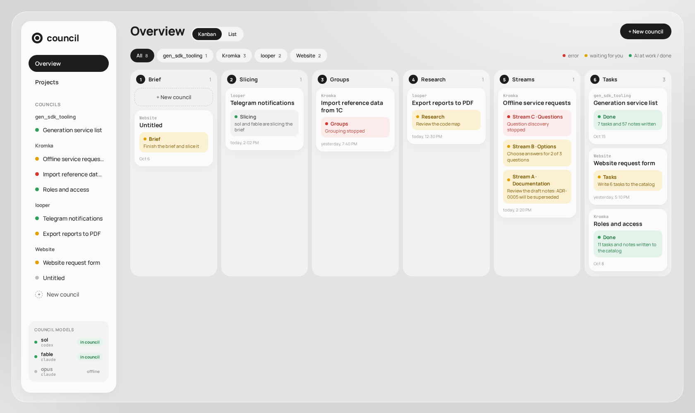
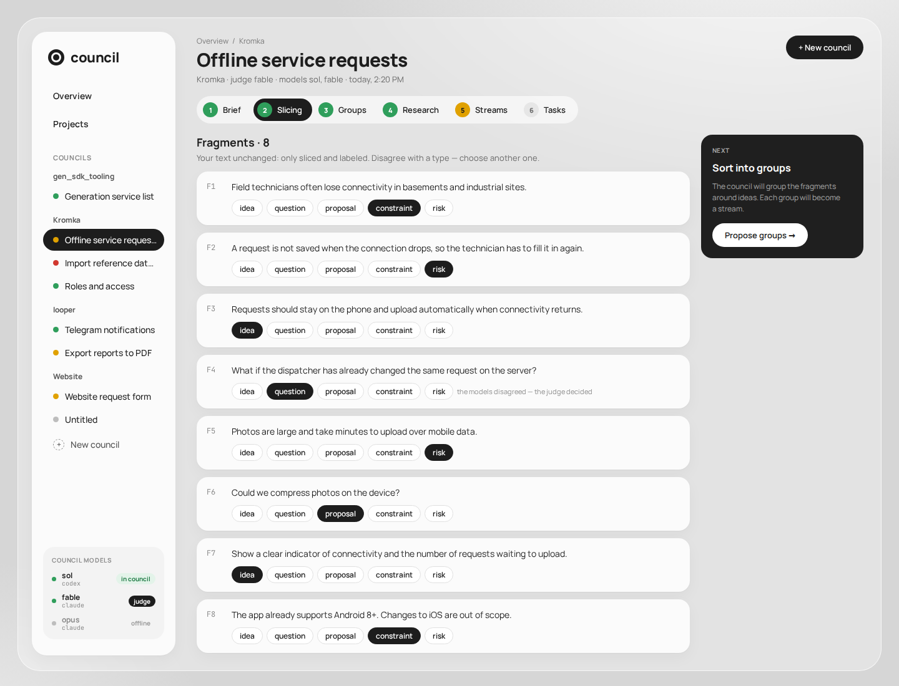
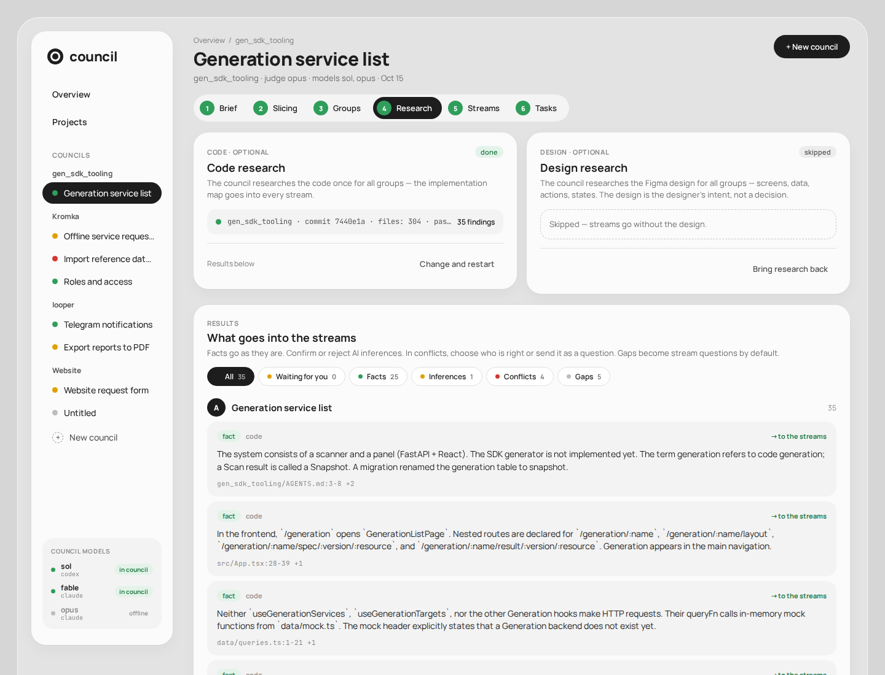
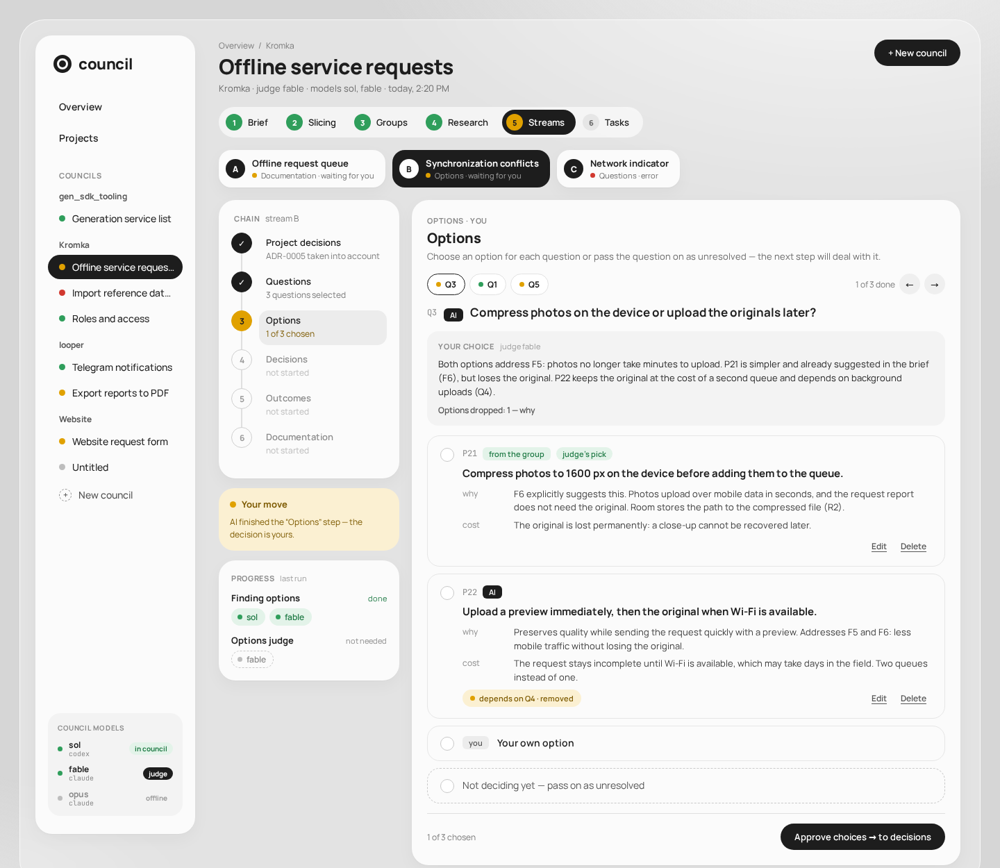
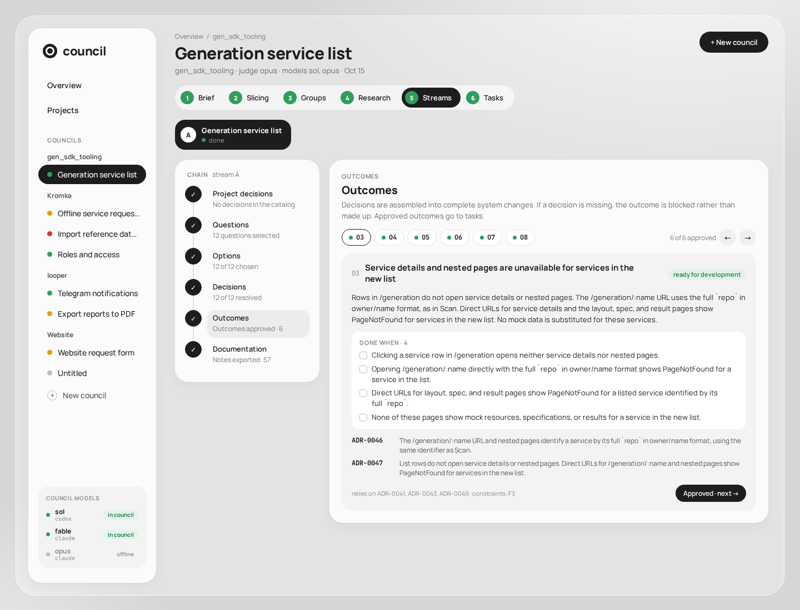
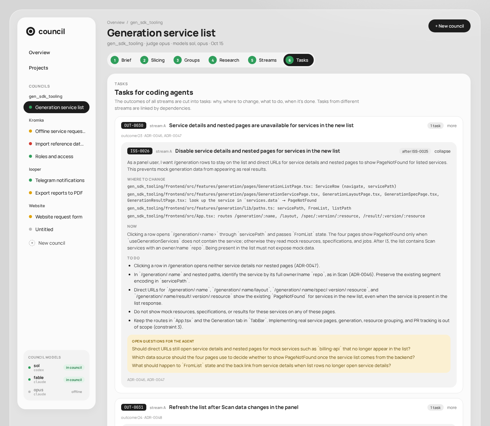

# Council Dev

**Turn a rough brief into decisions, specifications, and tasks for coding agents.**

Council Dev (Spec Council in the application) is a local planning tool. A council of language models breaks down your brief, investigates the existing code and an optional Figma design, surfaces open questions, and proposes options. You review the choices and approve the results before the council builds a task plan across all workstreams.

[How it works](#how-it-works) · [Try the interface](#try-the-interface) · [Installation](#installation) · [Configuration](#configuration) · [Русская инструкция](README.ru.md)



## What you get

- **A guided planning process.** Separate ideas, constraints, risks, questions, and proposals before turning them into a specification.
- **Multiple perspectives.** One or two participant models, plus a judge that reviews their results. Use Codex, Claude Code, or both.
- **Context from your project.** Optional repository and Figma research, plus earlier project decisions, inform the discussion.
- **Explicit human choices.** Edit questions, choose or write options, finalize decisions, and approve outcomes with acceptance criteria.
- **A handoff for coding agents.** Export linked Markdown notes and a shared task plan with dependencies and code context.

The application runs locally. Model work goes through the configured providers' CLIs and uses your signed-in accounts and subscription limits. Council Dev prepares the implementation handoff; the coding agent carries out the tasks separately.

## How it works

The six stages are **Brief → Slices → Groups → Research → Streams → Tasks**. Each group becomes a stream with its own review process; the final task plan brings the streams back together.

> Screenshots show the actual React application with English translations of the bundled sample materials. In a live council, set `COUNCIL_LANGUAGE=English` for English output. Interface language follows your browser.

### 1. Start with a brief

Create a council, give it a name, and paste your requirements in free form. Select a project if you want repository research and file exports, then choose the participants and judge from the models configured on your server.

You can start with incomplete requirements: unresolved questions are part of the process.

### 2. Separate the input, then organize it around ideas

The council splits the brief into fragments and labels them by role: idea, constraint, risk, question, or proposal. Review the labels, then ask it to propose groups. Rename, merge, or split groups before confirming them.



### 3. Ground the discussion in code and design

Optionally investigate repositories attached to the project and a Figma design. Review the findings and decide what to bring into the streams. Both kinds of research can be skipped.



### 4. Work through questions and choices

Each stream follows the same sequence:

| Step | What happens |
| --- | --- |
| **Project decisions** | Select earlier decisions and context that this stream should consider. |
| **Questions** | Review the council's open questions; remove questions or add your own. |
| **Options** | Compare proposed answers, their rationale, costs, and dependencies. Choose, edit, or write an option; leave a question unresolved when needed. |
| **Decisions** | Review the resulting decisions and consistency checks, address problems, and finalize them or leave them open. |
| **Outcomes** | Review the intended behavior, acceptance criteria, constraints, and any remaining gaps or blockers. |
| **Documentation** | Preview the linked notes and write the stream to the project's documentation folder. |

The judge's recommendation is visible alongside the alternatives. You make the choice.



### 5. Approve outcomes and export the handoff

Outcomes connect the agreed behavior and acceptance criteria to the decisions behind them. Review gaps and blockers before approving them.



Once every stream has been written to the documentation catalog, the council builds **one task plan across all streams**. Review each task's dependencies, code locations, current behavior, required changes, and open questions, then write the tasks to the project's tasks folder.



Model steps run on the server, so you can close the page while they work. Failed steps can be retried, reusing already completed model responses where available.

## Try the interface

Explore the bundled examples without a backend, provider login, or model subscription. Requires Node.js 20.19 or newer and npm:

```bash
git clone https://github.com/RusselSand/council-dev.git
cd council-dev
npm --prefix frontend ci
npm --prefix frontend run dev:mock
```

Open **http://localhost:5420**. This is a UI demonstration with mock data and actions; running a real council requires the setup below.

## Installation

Run the following commands from the repository root unless stated otherwise.

### 1. Prerequisites and repository access

Install Git, [uv](https://docs.astral.sh/uv/getting-started/installation/), Node.js 24 with npm, and Docker with Compose v2. `uv` installs the required Python 3.14 automatically. Docker is optional if you run the services directly.

For model work, you need an account with a subscription supported by the Codex or Claude Code CLI. The default council uses both providers; you can configure a council using just one.

The backend depends on the public [`RusselSand/agent-workers`](https://github.com/RusselSand/agent-workers) repository, pinned to a release tag. `uv` downloads it automatically during installation. No GitHub login or repository access token is required.

### 2. Create your configuration

```bash
git clone https://github.com/RusselSand/council-dev.git
cd council-dev
cp .env.example .env
```

On Linux, also set `COUNCIL_UID` and `COUNCIL_GID` to the output of `id -u` and `id -g`. Leave them unset on Windows and macOS.

For English model output and exported notes:

```dotenv
COUNCIL_LANGUAGE=English
COUNCIL_NOTES_LANGUAGE=English
```

### 3. Choose your council

The defaults are defined in [`.env.example`](.env.example):

```dotenv
COUNCIL_PARTICIPANT_1=sol=codex/gpt-5.6-sol
COUNCIL_PARTICIPANT_2=fable=claude/claude-fable-5-1
COUNCIL_JUDGE=fable
```

A participant is `name=provider/model`. Providers are `codex` and `claude`; model identifiers must be recognized by the corresponding CLI. The judge can be a participant's name or a separate `name=provider/model` definition.

For a single participant that also acts as judge, for example:

```dotenv
COUNCIL_PARTICIPANT_1=fable=claude/claude-fable-5-1
COUNCIL_PARTICIPANT_2=none
COUNCIL_JUDGE=fable
```

With two participants, the judge defaults to the second; with one, it defaults to that participant. An empty `COUNCIL_PARTICIPANT_2` keeps the default second participant; use `none` to disable it. Models on the same subscription share its limits. You can narrow the configured lineup for an individual council on the Brief screen.

### 4. Sign in to the model CLIs

Install only the providers you use. These versions match the repository's Docker images:

```bash
npm i -g @openai/codex@0.162.1
npm i -g @anthropic-ai/claude-code@2.1.282
```

Sign in once per model, using its configured name as the account directory. For the default lineup:

```bash
uv run --project backend python -m agent_workers login --provider codex --home .accounts/sol
uv run --project backend python -m agent_workers login --provider claude --home .accounts/fable
```

The commands open a browser. For Codex, choose **Sign in with ChatGPT**. Check the connection and subscription usage with:

```bash
uv run --project backend python -m agent_workers status --provider codex --home .accounts/sol
uv run --project backend python -m agent_workers status --provider claude --home .accounts/fable
```

Use the same provider and directory for `logout`. Each model needs its own directory, even when two models use the same account. If you set `COUNCIL_ACCOUNTS`, use that location instead of `.accounts`; otherwise the server will not find the login. Docker mounts these account directories, so no additional login inside a container is needed.

### 5. Start the application

```bash
docker compose up --build
```

Open **http://localhost:5420**; the API is at **http://localhost:8420**. Create a council and check that its models are connected on the Brief screen. Paste a short brief and start slicing.

Stop with Ctrl+C or `docker compose down`. To update:

```bash
git pull
docker compose up --build
```

After dependency changes, use `docker compose up --build -V` to refresh the anonymous dependency volumes.

<details>
<summary><strong>Run without Docker</strong></summary>

Follow steps 1–4, omitting Docker. Local `uv` fetches the public dependency automatically without GitHub credentials.

Start the backend in one terminal:

```bash
uv --directory backend run uvicorn spec_council.app:app --reload --port 8420
```

Start the frontend in another:

```bash
npm --prefix frontend ci
npm --prefix frontend run dev
```

Open http://localhost:5420. The Vite development server proxies `/api` to the backend on port 8420.

</details>

<details>
<summary><strong>Serve the built frontend and API together</strong></summary>

With Docker:

```bash
docker compose --profile prod up app --build
```

Open http://localhost:8080.

Without Docker:

```bash
npm --prefix frontend ci
npm --prefix frontend run build
uv --directory backend run uvicorn spec_council.app:app --port 8420
```

Open http://localhost:8420.

</details>

## Connect a project

Projects hold the settings reused by councils: repositories to research, a documentation folder, and a tasks folder.

1. Set `COUNCIL_REPOS` in `.env` to an existing directory containing your Git working copies, for example `COUNCIL_REPOS=..`, and restart Compose.
2. Create a project on the **Projects** screen and select up to 10 repositories. The app discovers working copies up to two directory levels below `COUNCIL_REPOS`.
3. Set a documentation folder, such as `my-app/docs/reasoning`, and optionally a separate tasks folder, such as `my-app/docs/tasks`. The tasks folder requires a documentation folder and must not be inside it.
4. Select the project on the council's Brief screen.

Paths shown in Docker are relative to `COUNCIL_REPOS`. Docker mounts that directory with write access for notes and tasks; models research a snapshot of the selected repositories. Use repositories you trust. Without Docker and without `COUNCIL_REPOS`, project paths are absolute.

### Optional Figma research

Create a personal access token from an account that can open the design:

1. In Figma, open your avatar menu → **Settings** → **Security** → **Personal access tokens** → **Generate new token**.
2. Grant **File content: Read-only** access and select an expiry date.
3. Copy the token immediately; Figma shows it only once. Add it to the root `.env`:

```dotenv
FIGMA_TOKEN=your-personal-access-token
```

4. Restart Compose, or restart the backend if running without Docker.
5. Open the council's **Research** stage, enter the Figma file link, and start design research.

The token reads files as its owner and uses that account's rate limit. Use an account with a Dev or Full seat for regular research: View and Collab seats have a much smaller allowance, and a scan makes several requests. Check your seat under **Settings → Account**; administrators can check **Admin → People → Seat type**. Renew the token when it expires, replace it in `.env`, and restart the backend. A token cannot grant access to a file its owner cannot open.

Design research is optional; skip it when you do not have a design or suitable Figma access.

## Configuration

Secrets and local settings live in the root `.env`, which is excluded from Git. See [`.env.example`](.env.example) for examples.

| Variable | Purpose / default |
| --- | --- |
| `COUNCIL_PARTICIPANT_1`, `COUNCIL_PARTICIPANT_2`, `COUNCIL_JUDGE` | Council lineup; see installation step 3. |
| `COUNCIL_ACCOUNTS` | Model login directory; defaults to `.accounts`. For a direct, non-Docker launch, `COUNCIL_<NAME>_HOME` can override a single model's directory. |
| `COUNCIL_REPOS` | Existing directory containing project working copies and export folders. |
| `COUNCIL_DATA` | Alternate council storage directory. If overridden, use a directory outside this repository and create it before starting Docker. |
| `COUNCIL_LANGUAGE` | Model output language; defaults to `Russian`. |
| `COUNCIL_NOTES_LANGUAGE` | Export language; defaults to the council output language. The judge translates notes and tasks when needed. |
| `FIGMA_TOKEN` | Optional Figma personal access token. |
| `AGENT_TIMEOUT`, `AGENT_IDLE_TIMEOUT` | Total model-turn and CLI inactivity timeouts, in seconds; defaults are 3600 and 900. An explicitly empty value removes the corresponding limit. |
| `COUNCIL_UID`, `COUNCIL_GID` | Required on Linux for container file ownership; leave unset on Windows/macOS. |

`COUNCIL_NOTES` is obsolete: configure the documentation folder on the project instead.

### Frontend settings

The default settings work for the standard installation. To override them, create `frontend/.env` using `frontend/.env.example`, or set environment variables before starting Vite.

| Variable | Purpose | Default |
| --- | --- | --- |
| `VITE_DATA_SOURCE` | `http` for the backend; `mock` for bundled demonstration data. | `http` |
| `VITE_API_URL` | API base URL used by the frontend in HTTP mode. | `/api` |
| `VITE_API_PROXY` | Backend address to which the Vite development server forwards `/api` requests. | `http://localhost:8420` |
| `VITE_USE_POLLING` | Set to `1` if file changes are not detected, for example with Docker on Windows. | Unset |

Restart the frontend development server after changing these settings. `dev:mock` selects mock mode automatically. The normal production build uses the backend on the same origin; when FastAPI serves the built frontend, `/api` resolves to that server.

The interface supports English and Russian and chooses its language from the browser's language preferences. This is separate from `COUNCIL_LANGUAGE`, which controls generated material, and `COUNCIL_NOTES_LANGUAGE`, which controls exports. Put English first in the browser's preferred languages and reload for an English interface.

## Data and agent handoff

Councils are stored as individual JSON files in `.data/`; projects are stored in `.data/projects/`. Docker mounts this directory so the data survives restarts and rebuilds. Account credentials live separately in `.accounts/`. Both default directories are excluded from Git and Docker build contexts. Back up your council data and exported project files as needed.

Coding agents can query the exported notes with a read-only CLI that returns JSON:

```bash
uv --directory backend run python -m spec_council.notes <notes-directory> chain IDEA-0002
uv --directory backend run python -m spec_council.notes <notes-directory> get ADR-0003
uv --directory backend run python -m spec_council.notes <notes-directory> list --type adr
uv --directory backend run python -m spec_council.notes <notes-directory> search "offline"
uv --directory backend run python -m spec_council.notes <notes-directory> validate
```

`chain` retrieves the notes linked to an idea; `get` returns a note and its status; `validate` checks the note graph. Relative note paths in these commands resolve from `backend/`.

## Troubleshooting

| Symptom | Check |
| --- | --- |
| Docker or local `uv` cannot fetch `agent-workers` | Check network access to GitHub. Run `git ls-remote https://github.com/RusselSand/agent-workers.git`; the repository is public and requires no credentials. |
| A model is not connected | Run `status`; its `--home` directory must match its configured name and account path. |
| Backend rejects the council configuration | Check the `name=provider/model` format and judge name. Restart after changing `.env`. |
| Linux permission errors | Set `COUNCIL_UID`/`COUNCIL_GID`, and check ownership of the mounted directories. |
| UI opens but API requests fail | Confirm the backend is running on 8420 and both configured ports are free. |
| A model step stops after a backend restart | Retry the step. Hot reload interrupts active model work. |
| Research stops | Check the displayed reason; inspect `scan.error` or `design_scan.error` in the council's JSON file for details. Check Figma token access, expiry, and rate limits if applicable. |

## Development

| Location | Contents |
| --- | --- |
| [`backend/`](backend/) | FastAPI server, council pipeline, prompts, note and task exports. |
| [`frontend/`](frontend/) | React, TypeScript, and Vite application; HTTP and mock data sources. |
| [`docs/api-contract.md`](docs/api-contract.md) | Backend/frontend API contract, in Russian. |
| [`docs/old/arch.md`](docs/old/arch.md) | Earlier architecture notes; frontend sections describe the old UI. |
| [`docs/screenshots/`](docs/screenshots/) | README screenshots and capture instructions. |

Checks, from the repository root:

```bash
uv --directory backend run ruff check .
uv --directory backend run pytest
npm --prefix frontend run typecheck
npm --prefix frontend run build
```
